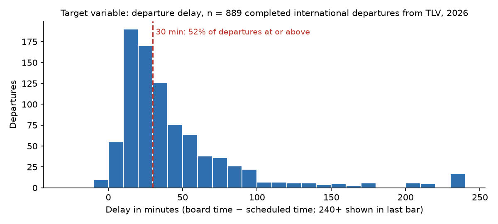

# FlyCheck ✈️ — Know before you book

FlyCheck helps travelers departing from **Ben Gurion Airport (TLV)** judge a flight *before* buying a ticket. It shows how often similar flights were delayed, and how busy the departure hall usually is when you arrive at the airport.

> Academic MVP. Course: Vibe Coding with Claude, Ariel University, Fall 2026.

## The problem

When you book a flight from TLV you can compare price, airline and departure time. Booking sites don't tell you:

- How often does this airline or departure time leave 30+ minutes late?
- How crowded is the terminal likely to be when I arrive, 3 hours before departure?

FlyCheck answers these questions from historical flight records, a machine-learning model and interactive charts. It is decision support, not a live flight tracker, and it never guarantees what will happen to a specific flight.

**Project statement:** Travelers departing from TLV suffer from not knowing, before they book, how likely their flight is to be delayed or how crowded the airport will be when they arrive. We are building FlyCheck, a Streamlit app that uses the official airport flight-board records and a machine-learning model to estimate delay risk and airport activity for a flight they are considering.

### Persona and scenario

> *The persona is fictional, made up to illustrate the target user.*

**Noa, 34, project manager from Rehovot**, flies to Europe for work four or five times a year. She books her own flights, usually choosing between two or three options with similar prices. Last time her evening flight to Berlin left 90 minutes late and she missed a client dinner. Next month she has to be in Berlin by noon. Before paying she opens FlyCheck, enters the 06:00 and 17:30 options, and compares how often each airline and departure time left 30+ minutes late, and how busy the airport usually is when she would arrive. She picks the option that fits her priorities.

### User stories

1. As a traveler considering a flight, I want to enter its published details and see how often similar flights were delayed 30+ minutes, so I can judge the risk before paying.
2. As a traveler, I want to see how busy the airport is likely to be when I arrive, not just when my flight departs, so I can plan my trip to the airport.
3. As a traveler comparing several flights, I want to see their delay risk, airport activity and my own price notes side by side, so I can choose by my own priorities.

### Risks and what we do if they happen

| Risk | Type | If it happens |
|---|---|---|
| The labelled data is small (889 departures from 10 days) and no model beats the simple airline-rate baseline | Data | We requested a year-long archive of the same official board (Rank Air) and EUROCONTROL research data. Decision point: Dec 1, 2026. Without them, the app shows the honest historical rates and labels them as such, instead of a model that is no better. |
| A model or feature silently uses information that is only known after the flight (leakage) | Technical | Features are limited to what is known at booking; the actual time, `delay_minutes` and status are excluded and tested. Evaluation is always on later days than training. |
| The schedule slips (course deadlines, data arriving late) | Schedule | The pipeline already accepts a new source with only a loader, so a late dataset does not force a rewrite. We cut optional extras (weather, live card, price conversion) before core outputs. |

## Simplified app design

**[Open the simplified FlyCheck page](https://claude.ai/artifact/Cb6JECwreqzy6hxNtkR1e8)** (public link). The source is in [`docs/app_artifact.html`](docs/app_artifact.html).

It is a simpler, user-facing version of the app design, in a liquid-glass style with airplane animations. Each question gets one plain answer, and the numbers behind it are one tap away. It has four pages:

| Page | What it answers |
|---|---|
| **Check a flight** | "Will it leave on time?": how many in 10 of the airline's flights left 30+ min late. "How crowded will the airport be?": Quiet / Moderate / Busy when you arrive |
| **Compare** | The same two answers for several flights side by side, with an optional price |
| **Airport tips** | When to arrive, terminals, parking, getting there, carry-on, lounges |
| **About the data** | Key numbers and charts; sources, limitations, models and cleaning steps collapsed below |

The delay answer uses the airline's historical rate on the airport board, the best baseline in `models/metrics.json`. With fewer than 10 departures for the airline, it uses the rate of all flights and says so. No model predictions are shown. To rebuild the page from the current processed data, run `python docs/artifact/build.py`. It fills [`docs/artifact/template.html`](docs/artifact/template.html).

## App prototype

**[Open the interactive prototype](https://claude.ai/artifact/P39yWMPVP7GJLMZgTsXeL4?sk=TCwr40dUzM0DzY7Z0TZDjA#analyze)** (public link). The source is also in [`docs/app_prototype.html`](docs/app_prototype.html).

The prototype shows the planned app layout. Its historical numbers are real; no model predictions are shown yet. It has five pages:

| Page | What it does | Status |
|---|---|---|
| **Analyze a flight** | Enter airline, destination, date and time. Shows the historical delay reference and the departure-hall activity at your arrival time, with an hourly chart | Historical parts work; the ML probability comes in M3 |
| **Compare flights** | Add options and sort them by delay history, hall activity or the price you enter | Works on historical data |
| **Explore data** | Delay distribution, delay by hour, airlines, destinations, airline reliability, airfare price index | Real data |
| **Airport guide** | When to arrive, terminals, parking, trains and buses, carry-on rules, lounges | Static content with official links |
| **About & data** | Cleaning funnel, sources, limitations, project status | Real data |

## Project status

| Step | Due | Status |
|---|---|---|
| Data audit (feasibility, schema, coverage) | — | ✅ Done (Nov 18) |
| Data download + cleaning pipeline + tests | — | ✅ Done |
| App prototype | — | ✅ Done |
| **M2**: clean data + EDA notebook ([`notebooks/eda.ipynb`](notebooks/eda.ipynb)) | Nov 25 | ✅ Submitted (see [M2 summary](#m2-eda-notebook-nov-25)) |
| Streamlit analytics dashboard (built for the old M2 guidelines; kept for M3) | — | ✅ Built |
| Baselines + training/evaluation pipeline for 3 targets | — | ✅ Built (34 tests passing) |
| **M3**: delay model trained, evaluated, integrated | Dec 16 | Planned |
| Deployment to Streamlit Community Cloud | Dec 23 | Planned |
| Final demo | Jan 6, 2027 | Planned |

The step-by-step plan is in [PLAN.md](PLAN.md). Decisions and progress are logged in [WORKLOG.md](WORKLOG.md), in Hebrew.

## M2: EDA notebook (Nov 25)

**The M2 deliverable is the Jupyter notebook [`notebooks/eda.ipynb`](notebooks/eda.ipynb)** (in Hebrew). It runs from top to bottom with *Restart & Run All*, and its outputs are saved. Every chart has a written conclusion under it, and all the conclusions are also collected in [`docs/eda_findings.md`](docs/eda_findings.md).

| Requirement | What we have | Where |
|---|---|---|
| **Clean data**: 300+ rows, both classes, every cleaning decision | 889 labelled departures (5,213 flights in total), one row per physical flight; 52.1% delayed, 47.9% not | `data/processed/flights.parquet` · [Data Card](#data-card) · [What we fixed and why](#what-we-fixed-and-why) · notebook section 0 |
| **EDA**: the four questions | 1. Column types · 2. Quality: missing values, duplicates, wrong values, outliers · 3. Distributions, including the target's balance · 4. Correlation with y, including a leakage check | Notebook sections 1–4 |
| **Insight** | Delays build up during the day (below) | Top of the notebook, section 4, this README |
| **Baseline** | Most common class and its accuracy (below) | Top of the notebook, section 5, this README |

### How y is computed

The target is **computed by a formula** from two measured times on the official board; nobody labelled it by hand:

```text
delay_minutes = actual departure time − scheduled departure time   (minutes, Israel local time)
delayed_30    = 1 if delay_minutes ≥ 30, else 0
```

It is computed only for completed international departures (final status `DEPARTED`). Because y is a function of the actual time, the actual time, `delay_minutes` and the final status are **never used as features**: the notebook checks that each of them reproduces y exactly (leakage). The model may only use what a traveler knows at booking: airline, destination, scheduled hour and weekday.

### Insight

**We found that delays build up during the day.** Departures scheduled before 12:00 left 30+ minutes late 45% of the time (n = 449); from 18:00 the share was 63% (n = 142). This is not only because different airlines fly in the evening: within El Al alone it went from 32% (n = 161) to 64% (n = 42). On the two fully logged days (Jun 25 and Jul 2, 2026) it went from 48% to 78%. For a traveler who cares about delays, a morning flight is usually the safer choice.

Secondary finding: the airline has the strongest link to y (Cramér's V 0.42). Among airlines with 20+ flights, the delay rate ranges from 7% (flydubai) to 81% (TUS); El Al is 46%.

### Baseline

| Baseline | Accuracy | ROC-AUC |
|---|---|---|
| **Most common class** ("always delayed"), all 889 departures | **52.1%** | — |
| **Most common class, chronological split** (train: 538 departures up to Jul 2, 2026; test: 351 departures on Jul 3 and Nov 17–18) | **41.9%** | 0.50 |
| Airline's delay rate from the training days | 58.4% | 0.64 |

Why the two majority-class numbers differ: on all rows "delayed" is the majority (52.1%). In the chronological split the model learns "delayed" from the training days (59% delayed), but only 41.9% of the test days are delayed, so always predicting "delayed" is right 41.9% of the time. M3 is evaluated on the chronological split, so **41.9% is the minimum to beat and the airline rate (58.4%, ROC-AUC 0.64) is the real target**. A first logistic regression and random forest did not beat it (ROC-AUC ≈ 0.52). Full metrics: `models/metrics.json`.

The test days are biased towards "on time": on the last logged day of each source, many late evening flights had not left yet when logging stopped (notebook section 4). This will be handled before M3.

The Streamlit dashboard built for the earlier M2 guidelines (`python -m streamlit run app.py`, page **Explore data**) shows the same insight and baselines interactively.

## Data

| Source | What we use | License / terms |
|---|---|---|
| [Flight board archive](https://www.odata.org.il/he/dataset/flydata) by The Octopus (odata.org.il) | Snapshots of the Israel Airports Authority flight board, with scheduled and actual times | CC BY |
| [data.gov.il flight board](https://data.gov.il/dataset/flydata) | Current board (about 1 day back, 3–4 days ahead): recent schedule and live status | Open (data.gov.il) |
| [TLVFlights statistics](https://www.tlvflights.com/en/flight-statistics/?range=all) | Airline-level reliability (about 101k flights, Dec 2025 – Nov 2026) | Free to use with a link |
| [Israel CBS price index 121390](https://api.cbs.gov.il/index/data/price?id=121390&format=json&lang=en) | Monthly "travel abroad and local flights" index, as price context | Public |

### What the data looks like after cleaning

There are two flight sources:

- **The OData archive** logs the board on only 4 days (Jan 17, Mar 17, Jun 26, Jul 3 2026).
- **One data.gov.il board snapshot** (Nov 18, 2026) adds Nov 17–20.

TLV was closed from Feb 11 to May 15, 2026.

| Step | Rows |
|---|---|
| Raw board rows (225,500 archive + 1,827 snapshot) | 227,327 (3 truncated lines skipped) |
| Unique flight listings (latest snapshot kept) | 7,507 |
| Physical flights (codeshares merged) | 5,213 |
| Departures | 2,595 (931 completed, 27 cancelled, 1,637 without a final status yet) |
| **Labelled departures** (completed, international, trusted delay) | **889** |

Of the 889 labelled departures, 52.1% left 30+ minutes late; the median delay is 31 minutes.

Nothing is deleted silently. Domestic flights (41) and one likely unrecorded schedule change (a flight that "left" 127 min early) are flagged and counted in `data/processed/cleaning_report.json`.

**Larger sources requested:**

- a year-long archive of the same official board (Rank Air);
- EUROCONTROL research flight data.

The pipeline converts every source into one internal flight schema, so a new source only needs a loader.

### Data Card

| Field | |
|---|---|
| **Source and link** | Israel Airports Authority flight board. Archive by The Octopus: [odata.org.il/he/dataset/flydata](https://www.odata.org.il/he/dataset/flydata). One snapshot of the live board: [data.gov.il/dataset/flydata](https://data.gov.il/dataset/flydata). Downloaded Nov 18, 2026 by `src/download_data.py`, which records each file's URL, time, size and SHA-256 in `data/raw/manifest.json`. |
| **Size and format** | Raw: a CSV of 225,500 board snapshot rows × 20 columns, plus a JSON snapshot of 1,827 rows. Cleaned: `data/processed/flights.parquet`, 5,213 rows (one per physical flight) × 25 columns. 889 of them are labelled departures. Main columns: `scheduled`, `airline_code`, `airport_code`, `country`, `hour`, `weekday`, `terminal`, `delay_minutes`, `delayed_30`. |
| **Target variable (y)** | `delayed_30` (binary): 1 if `delay_minutes` ≥ 30. `delay_minutes` = board time − scheduled time, in minutes, Israel local time. 52.1% of labelled departures are 1. Delay median 31 min, mean 47, range −21 to 386. |
| **Missing values and problems** | Each flight appears up to 86 times (one row per board refresh). Codeshares list one plane under several flight numbers. 3 CSV lines are truncated. `delay_minutes` is empty for 64% of flights by design: arrivals, 27 cancellations, and 1,637 departures with no final status when logging stopped. Check-in counter and zone are missing for 57%. One flight "left" 127 min early, which is likely an unrecorded schedule change. |
| **License and biases** | CC BY (attribution required); the data.gov.il board is open. **Biases:** only 10 scheduled days, all around the wartime airport closure (Feb 11 – May 15, 2026), so there is no seasonality. El Al is 33% of labelled departures. On the last logged day of each source, late flights had often not departed when logging stopped, so delayed evening flights are likely under-represented there. The evening share was 0–20% on Jul 3 and Nov 18, against 77–79% on fully covered days. The board's "actual" time is close to takeoff, not gate departure. |



### What we fixed and why

1. **Kept one row per flight.** The board was logged every few minutes, so one flight appeared up to 86 times. We keep each flight's latest snapshot (227,327 rows → 7,507 listings). Otherwise busy flights would be counted dozens of times, and early "ON TIME" snapshots would hide the final delay.
2. **Merged codeshares.** One plane sold under several flight numbers (for example AZ 807 + LH 5233) becomes one physical flight (7,507 → 5,213). Otherwise routes with many partner airlines would weigh several times more than they should.
3. **Labelled only real outcomes, and flagged instead of deleting.** The delay target uses only completed departures with a real departure time. Cancelled flights (27) and flights with no final status (1,637) are kept but left out of the target. Filling them in would invent on-time flights. Domestic flights (41) and the "127 min early" flight are flagged out of scope and counted in `data/processed/cleaning_report.json`.

4. **Skipped broken lines.** 3 truncated CSV lines are skipped and counted instead of crashing the load, so the rest of the file is still used.
5. **Removed one impossible departure, kept real outliers.** One flight "left" 127 minutes early, which is almost certainly an unrecorded schedule change, so it is excluded (rule: leaving more than 30 minutes early is suspect). We kept the 11 departures that left up to 21 minutes early and the 30 delays over 3 hours (up to 386 min): their times are consistent, and since y is binary they cannot distort it.
6. **Removed domestic flights.** The 41 domestic departures (to Israeli airports such as Eilat) are a different product from the international flights FlyCheck covers, so they are flagged out of scope.
7. **Left structural gaps empty.** Check-in counters and zone are missing in 57% of rows: they are never given for arrivals, and they are only known close to departure. We do not fill them with 0 or an average, and they are not model features. The columns the model uses have no missing values.
8. **Fixed the time zone.** The board times have no time-zone mark. We checked them against the live board on Nov 18, 2026: they are Israel local time, and all delays are computed in that zone, including flights that cross midnight.
9. **Checked for duplicates after cleaning.** There are none by (airline, flight number, date).

The notebook shows each of these decisions with its numbers (sections 0 and 2).

## How to run

```bash
python -m venv .venv
# Windows: .venv\Scripts\activate   |   macOS/Linux: source .venv/bin/activate
python -m pip install -r requirements.txt

python -m src.download_data      # downloads raw data into data/raw/ (+ manifest.json)
python -m src.data_processing    # builds data/processed/flights.parquet + cleaning_report.json
python -m src.train              # baselines + models for delay, cancellation, airport activity
python -m pytest                 # runs the tests (pipeline, analytics, models, every app page)
python -m streamlit run app.py   # opens the app at http://localhost:8501
```

The M2 notebook needs only the committed processed data (no download or training):

```bash
jupyter notebook notebooks/eda.ipynb   # then Kernel → Restart & Run All
# or, headless:
jupyter nbconvert --to notebook --execute notebooks/eda.ipynb --output /tmp/eda_check.ipynb
```

### Adding a larger dataset

The pipeline is ready for a larger archive; no code changes are needed for the supported formats.

1. Put the files in `data/raw/`:
   - **Rank Air export:** any CSV in `data/raw/rankair/`, with the column names from their database or CSV.
   - **More board snapshots:** `python -m src.download_data` adds `data/raw/govil/board_*.json`.
2. Run `python -m src.data_processing`. Every source is loaded, converted to one schema, and merged; the latest snapshot of each flight wins.
   - Rank Air times may be stored with a timezone. The loader tests both readings against the overlapping archive days and keeps the one that matches. The result is in `cleaning_report.json` → `sources.rankair`.
3. Run `python -m src.train`, then `python -m pytest`.
   - Each model is shown in the app **only if** it clearly beats the best baseline on the held-out latest days.
   - Cancellation gets a model automatically once there are enough cancellations (≥ 50 in train, ≥ 10 in test).
4. Check the data license before committing. `data/processed/flights.parquet` contains every source's rows. If a source may not be redistributed, commit only `models/` and keep the processed file local.

The processed files in `data/processed/` are committed, so the app runs right after installing the requirements. Raw data is not committed; `src/download_data.py` re-downloads it and records the source URL, retrieval time, size and SHA-256 of each file.

## Repository structure

```text
FlyCheck/
├── README.md            this file
├── CLAUDE.md            project context and verified data findings (for the AI assistant)
├── PLAN.md              step-by-step build plan
├── WORKLOG.md           decisions and progress log (Hebrew)
├── requirements.txt     pinned dependencies
├── app.py               Streamlit entry point (navigation)
├── app_pages/           one file per page: analyze, compare, explore, guide, about
├── notebooks/
│   └── eda.ipynb            M2 EDA notebook (Hebrew)
├── docs/
│   ├── eda_findings.md      all EDA conclusions (Hebrew)
│   ├── M2_pitch.md          M2 pitch script (Hebrew)
│   ├── M2_TASKS.md          M2 work split (Hebrew)
│   ├── img/                 README images (target histogram)
│   ├── app_artifact.html    simplified app page
│   ├── artifact/            build script + template for the simplified page
│   └── app_prototype.html   interactive app prototype
├── src/
│   ├── download_data.py     reproducible raw-data download
│   ├── sources.py           adapters: OData archive, data.gov.il snapshots, Rank Air export
│   ├── data_processing.py   cleaning, deduplication, delay target, context data
│   ├── analytics.py         hourly activity, congestion index, historical delay rates
│   ├── features.py          booking-time features (no outcome information)
│   ├── estimators.py        airline-rate baseline (sklearn-compatible)
│   ├── train.py             baselines vs models for 3 targets, chronological split, gate
│   └── predict.py           inference for the app (only gated models)
├── models/              metrics.json, hourly profile, fitted pipelines
├── tests/               pipeline, analytics, sources, models and page smoke tests
└── data/
    ├── raw/             git-ignored; rebuilt by download_data.py
    └── processed/       cleaned flights, cleaning report, TLVFlights and price-index tables
```

## Method in brief

- **Delay target:** `delay_minutes` = board time − scheduled time, for departures whose final status is DEPARTED. `delayed_30` = delay ≥ 30 min. Times are Israel local time (checked against the live board on Nov 18, 2026).
- **Three targets, each with baselines and a model** (`python -m src.train`). Evaluation is chronological: the latest days are the test set, and historical aggregates come from the training days only.

  | Target | Baselines | Model | Result on current data |
  |---|---|---|---|
  | Delay 30+ min | majority class, overall rate, airline rate | logistic regression, random forest | Airline rate is best (ROC-AUC 0.64); no model clearly beats it |
  | Cancellation | overall rate, airline rate (archive, TLVFlights) | logistic regression | Baselines only: 26 cancellations, too few for a model |
  | Departures per hour | hourly mean, weekday-hour mean | random forest regressor | Hourly mean is best (MAE 3.4) |

- **When a model is used:** only if it clearly beats the best baseline on the test days. That means the 95% paired-bootstrap interval of the Brier improvement is above zero, and its ROC-AUC is higher. Otherwise the app shows historical rates. Features are only things known before booking: airline, destination, country, weekday, hour, holidays, scheduled activity.
- **Departure-hall activity:** the number of international departures scheduled 1–4 hours after you arrive, ranked against all hours of the day (0–100, low / medium / high). It is a relative index, not a measurement of queues or waiting time.

## Limitations

- The labelled sample is small (889 departures) and comes from an unusual period around the airport closure. It cannot show seasonality.
- The board's "actual" time is close to takeoff, not gate departure.
- FlyCheck does not predict ticket prices or security-queue times; no public data exists for them.
- Historical patterns are not a guarantee about any future flight. Always follow official airline and airport guidance on when to arrive.

## Team

| Name | Faculty | Role | GitHub |
|---|---|---|---|
| Tal Hadary | Computer Science | Data | [countDookim](https://github.com/countDookim) |
| Omer Barak | Mechanical Engineering | Product | |
| *to fill* | *to fill* | *to fill* | |
| *to fill* | *to fill* | *to fill* | |

Course roles: Product, Programmer, Data, UI/UX.

Every team member commits to this repository (course requirement).

## Attribution

- Flight board data: Israel Airports Authority via data.gov.il, archived by The Octopus (odata.org.il), CC BY.
- Airline statistics: [tlvflights.com](https://www.tlvflights.com).
- Price index: Israel Central Bureau of Statistics.
